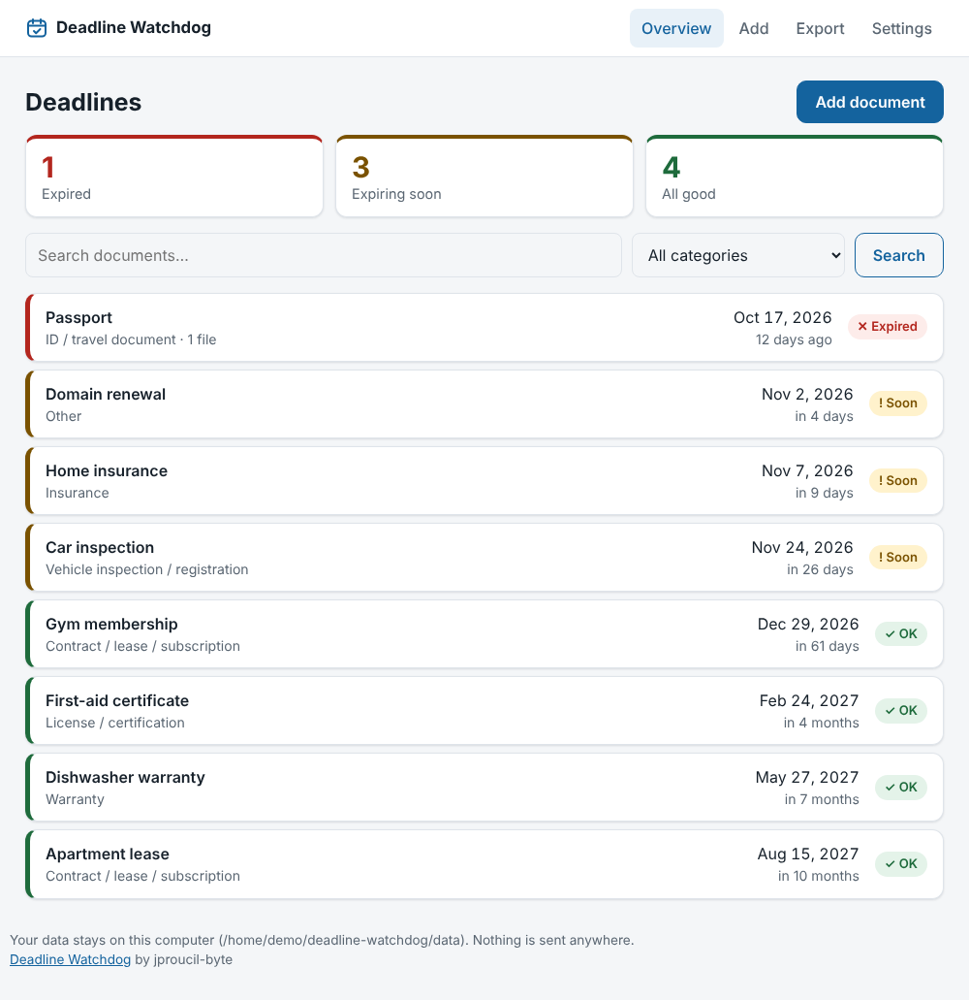
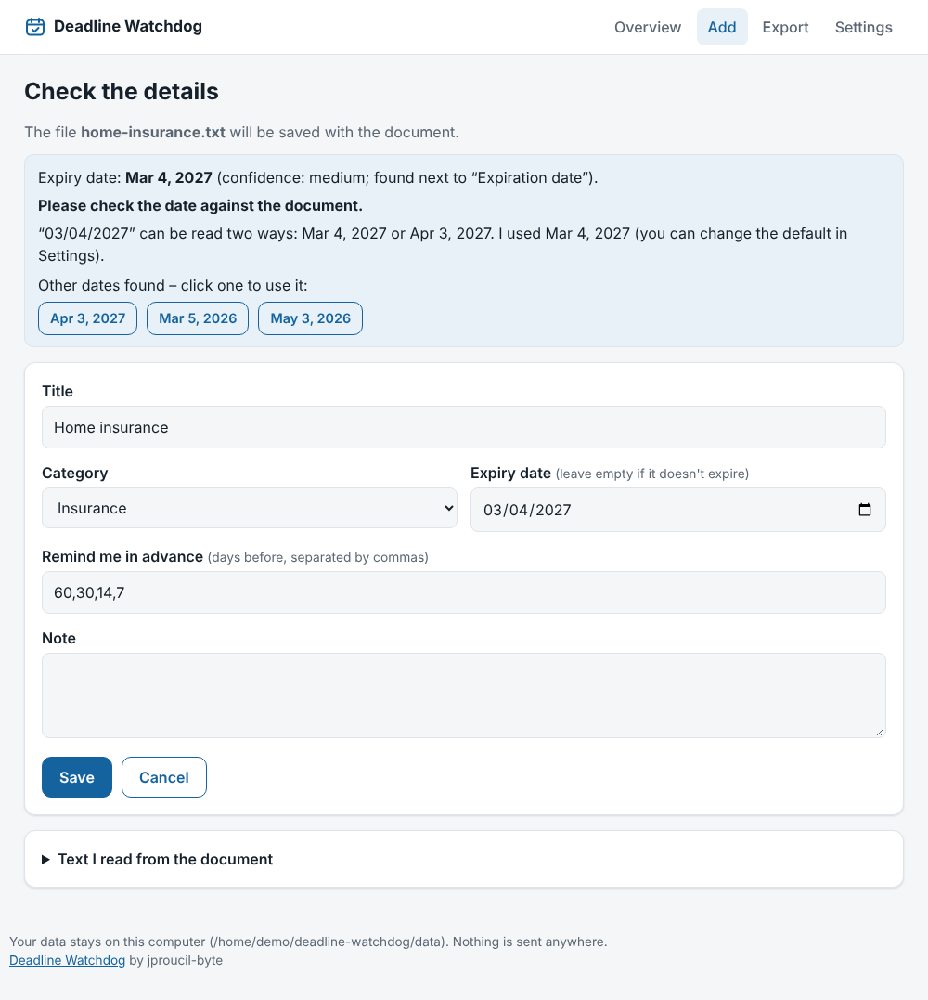

# Deadline Watchdog (česky)

[](https://github.com/jproucil-byte/Deadline-Watchdog/actions/workflows/tests.yml)

Malá lokální aplikace, která hlídá konce platnosti: pojištění, STK a registrace vozidel, záruky, nájmy a smlouvy,
doklady, osvědčení, faktury. Nahraješ fotku nebo PDF, program vyčte datum konce platnosti, ukáže ti ho ke kontrole
a pak ti včas dá vědět.

*Hlavní jazyk je angličtina, čeština je zabudovaná a přepíná se v Nastavení.*

- **Bez internetu, bez účtu, bez serveru.** Všechno běží na tvém počítači, nic se nikam neposílá.
- **Žádné závislosti.** Stačí Python. Na čtení skenů a fotek je volitelně potřeba Tesseract.
- **Data jsou v jedné složce** (`data/`), takže záloha i přenos na jiný počítač jsou triviální.

<p align="center">
  
  
</p>

*Ukázková data (screenshoty jsou v angličtině).*

Podrobný popis (v angličtině) je v `README.md`. Tady jen to hlavní.

## Spuštění

Potřebuješ Python 3.9 nebo novější. Windows: dvojklik na `start.bat`. macOS: `start.command`. Linux: `./start.sh`
(nebo `python3 watchdog.py`). Otevře se prohlížeč na `http://127.0.0.1:8765/`.

```
git clone https://github.com/jproucil-byte/Deadline-Watchdog.git
cd Deadline-Watchdog
```

Jazyk a pořadí číselných dat (03/04/2027 = 4. března, nebo 3. dubna?) se nastavují v **Nastavení**.
Datum se vždy zobrazuje jednoznačně (4. 3. 2027) a nejednoznačné zápisy ti program výslovně oznámí.

## Co umí navíc (verze 1.2)

- **Opakující se termíny:** u dokumentu nastav „Opakuje se“ (každý měsíc … každých 10 let) a tlačítko
  *Prodloužit o další období* posune konec přesně o tuhle dobu. Kalendář pak ukazuje i další období.
- **Štítky** (např. `auto, Jana`) seskupí dokumenty napříč kategoriemi; kliknutím na štítek v přehledu filtruješ.
- **Vlastní kategorie** přidáš v **Nastavení → Vlastní kategorie**.
- **Archiv:** věci, které už nepotřebuješ (prodané auto, zrušená smlouva), přesuneš do archivu. Zůstanou i se
  soubory, ale nezobrazují se, neposílají upozornění a nejsou v exportu do kalendáře.
- **Automatická záloha:** v **Nastavení → Automatická záloha** zvol složku (nejlépe v OneDrive/Dropboxu nebo na jiném
  disku), jak často zálohovat a kolik záloh nechat. Starší automatické zálohy se mažou, jiné soubory ve složce ne.

## Data ze starších verzí

Když spustíš tuhle verzi nad složkou `data/` z původního „Hlídače termínů“ nebo z Expiry Keeperu, databáze i kategorie se
při prvním spuštění automaticky převedou a nic se nemaže. Staré zálohy (`hlidac-zaloha-*.zip`) jdou taky obnovit.
Staré proměnné prostředí `KEEPER_*` a `HLIDAC_*` fungují dál, nové se jmenují `WATCHDOG_*`.

## Čtení různých souborů

Word, ODT a text: nic navíc. PDF s textem: `pdftotext` nebo `pip install pypdf`. Fotky a skeny: Tesseract
(pro češtinu navíc balíček `ces`, např. `sudo apt install tesseract-ocr tesseract-ocr-ces`). Skenovaná PDF: Tesseract
a `pdftoppm`. Stránka **Přidat** ukazuje, co z toho na tvém počítači program našel.

## Upozornění

1. Přehled v aplikaci. 2. Kalendář v telefonu: stránka **Export** → stáhni `.ics` (upozornění v 9:00 v předstihu,
který nastavíš u dokumentu). 3. Oznámení na ploše: na stránce **Export** klikni na *Zapnout automatická upozornění*
(nebo `python watchdog.py schedule`). Ve Windows se vytvoří úloha v Plánovači úloh (denně v 9:00 a po přihlášení,
bez práv správce a bez blikajícího okna), v macOS LaunchAgent, v Linuxu položka automatického spuštění po přihlášení.
Vypnutí: tlačítkem nebo `python watchdog.py schedule --remove`.

## Záloha

`python watchdog.py backup` nebo tlačítko v aplikaci. Obnova: nejdřív ukonči aplikaci, pak
`python watchdog.py restore zaloha.zip --yes` (současná data se přesunou do složky `data-before-restore-…`).

## Omezení

Čtení fotek není neomylné, proto datum vždy kontroluj. Vyzkoušeno na Linuxu a Windows 11 (včetně naplánovaných
upozornění); macOS je napsaný, ale nevyzkoušený.

## Autor

[jproucil-byte](https://github.com/jproucil-byte)
