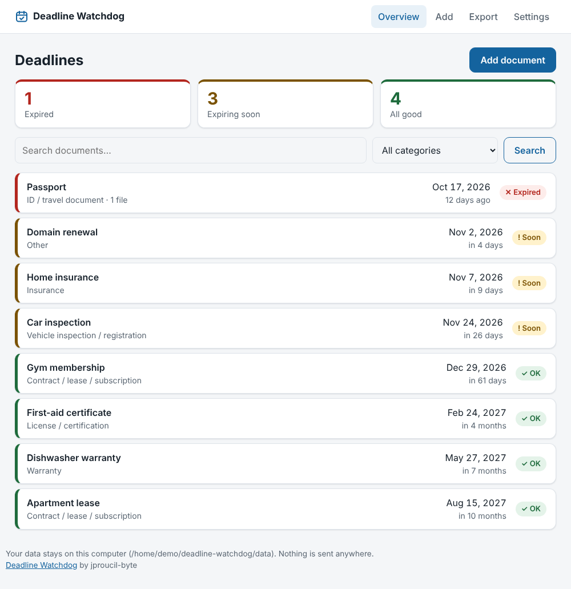
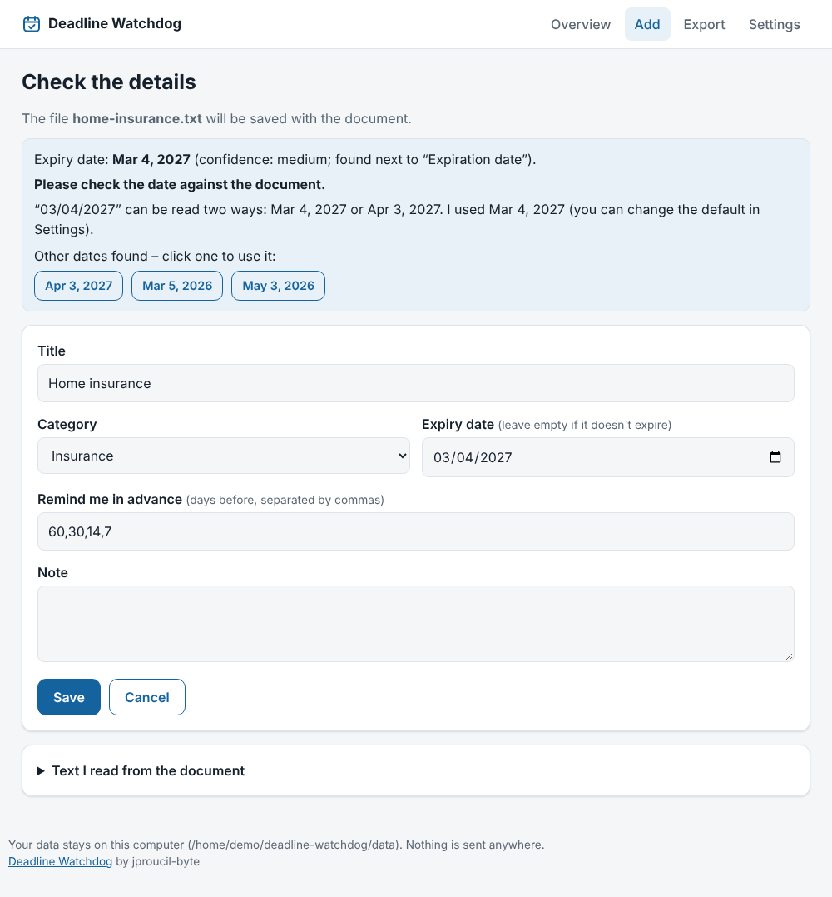
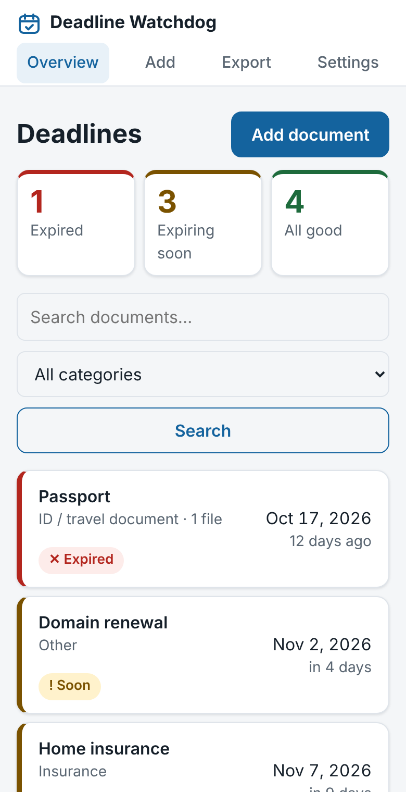

# Deadline Watchdog

[](https://github.com/jproucil-byte/Deadline-Watchdog/actions/workflows/tests.yml)


A small local app that keeps track of things that expire: insurance, vehicle inspections and registrations, warranties,
leases and contracts, IDs and licenses, certifications, invoices. Upload a photo or PDF, the app reads the expiry date,
shows it to you for confirmation, and then reminds you in time.

*English is the primary language; Czech is built in and can be switched in Settings.* Czech version of this page: [README.cs.md](README.cs.md).

- **No internet, no account, no server.** Everything runs on your computer and nothing is sent anywhere.
- **No dependencies.** Python is enough. Reading scans and photos optionally uses Tesseract (see below).
- **All data lives in one folder** (`data/`), so backup and moving to another computer are trivial.

<p align="center">
  
  
</p>
<p align="center">
  
</p>

*Demo data only. The second screenshot shows the date check: `03/04/2027` can mean March 4 or April 3, so the app says so and offers the other reading with one click.*

## Run it

You need Python 3.9 or newer ([python.org](https://www.python.org/downloads/); on Windows tick "Add python.exe to PATH"
in the installer). The test suite covers Python 3.9 to 3.13 (see `.github/workflows/tests.yml`).

```
git clone https://github.com/jproucil-byte/Deadline-Watchdog.git
cd Deadline-Watchdog
```

| System  | How to start                                                           |
|---------|------------------------------------------------------------------------|
| Windows | double-click `start.bat`                                               |
| macOS   | double-click `start.command` (the first time you may need `chmod +x start.command`) |
| Linux   | `./start.sh` (or `python3 watchdog.py`)                                  |

Your browser opens at `http://127.0.0.1:8765/`. Close the window or press `Ctrl+C` to stop.

## How it works

1. **Add** → choose a file (PDF, photo, Word…).
2. The app reads the text, suggests a title, a category and the **expiry date**, and tells you how sure it is.
   If it found several dates, you can switch to another with one click.
3. You check the details, correct anything and save. The file is stored with the document.
4. The overview shows what is **expired**, what **expires soon** and what is fine.
5. When you renew something, one click on its page moves the end date (+1 year, +2 years or an exact date).
   If you set **Repeats** (every month … every 10 years), the button *Renew for the next period* moves it by
   exactly that interval, and the calendar export shows the following periods too.
6. **Tags** (e.g. `car, Jane`) group documents across categories; click a tag in the overview to filter.
   Missing a category? Add your own in **Settings → Your own categories**.
7. Things you no longer need (a sold car, a cancelled contract) go to the **Archive**: they keep their files but
   stop showing up, stop sending reminders and leave the calendar export. You can move them back any time.

The date is **never saved blindly**: you always confirm it first. Text recognition makes mistakes, especially on photos.

### What it recognises

- Dates after phrases like *expires, expiration date, valid until / through, good through, renewal date, policy period
  … to …, due date, next inspection due, end date* (and the Czech equivalents), and the end of a *from … to …* period.
- Formats: `March 4, 2027`, `4 March 2027`, `Mar. 4th, 2027`, `04-Mar-2027`, `2027-03-04`, `03/04/2027`, `3.4.2027`,
  `06/2027` (= end of that month).
- It tries not to pick the date of issue, birth, purchase or signing (*issued, effective, DOB, date of purchase, invoice date*).
- For warranties it computes the end from the purchase date and the length ("2-year limited warranty", "warranty period:
  24 months").
- It guesses a category from the text and pre-fills sensible reminder lead times for it.

### Dates like 03/04/2027

With slashes the same text means March 4 in the US and 3 April almost everywhere else. The app can't know which one
your document uses, so:

- **Settings → Numeric dates** sets the default (month first for English, day first for Czech).
- If the day is above 12 (`12/31/2026`, `31/12/2026`) there is only one reading, and it is used.
- If both readings are possible, the app uses your default, lowers its confidence, **tells you about it**, and offers the
  other reading as a one-click alternative. Dates are always shown unambiguously (`Mar 4, 2027`).
- Dotted dates (`3.4.2027`) are always day.month.year.

### What is needed to read different files

| File                              | Needed                                                      |
|-----------------------------------|-------------------------------------------------------------|
| Word (.docx), .odt, .txt          | nothing                                                     |
| PDF with text                     | `pdftotext` (poppler) **or** `pip install pypdf`            |
| Photos (JPG, PNG, TIFF…), scans   | Tesseract                                                   |
| Scanned PDF                       | Tesseract **and** `pdftoppm` (poppler)                      |

The **Add** page shows what your computer has. Without these tools nothing breaks: you just enter the date by
hand and the file is still saved.

Optional installation:

- **Debian / Ubuntu:** `sudo apt install tesseract-ocr poppler-utils` (add `tesseract-ocr-ces` for Czech)
- **macOS (Homebrew):** `brew install tesseract poppler` (add `tesseract-lang` for other languages)
- **Windows:** install Tesseract from the UB Mannheim build (for example `winget install --id UB-Mannheim.TesseractOCR`;
  check the exact id with `winget search tesseract`). `pip install pypdf` is enough for PDFs with text. Scanned PDFs on
  Windows also need poppler (third-party binaries); the simpler way is to save the scan as an image.
- Tools outside your `PATH` can be set with `WATCHDOG_TESSERACT`, `WATCHDOG_PDFTOTEXT`, `WATCHDOG_PDFTOPPM` (path to the program).
- `WATCHDOG_OCR_LANG` overrides the Tesseract language (for example `eng+deu`).

## Reminders: three layers

1. **Overview in the app**: expired and approaching deadlines are at the top, marked by colour and by text.
2. **Calendar on your phone (the most reliable).** On the **Export** page download an `.ics` file and open it in Google,
   Apple or Outlook calendar. Every document becomes an all-day event on its expiry date, with alerts at 9:00 the number of
   days ahead you set (default for example 60, 30, 14, 7). It is a one-time export; download it again after changes.
3. **Desktop notifications.** On the **Export** page click *Turn on automatic reminders* (or run
   `python watchdog.py schedule`). The app then checks your deadlines by itself, even when it isn't open:
   - **Windows:** a Task Scheduler task runs every day at 9:00 and when you sign in; if the computer was off at 9:00
     it runs as soon as possible. It uses `pythonw.exe`, so no window flashes. No administrator rights are needed.
     Notifications appear in the Windows notification centre.
   - **macOS:** a LaunchAgent, every day at 9:00 and at log in.
   - **Linux:** a desktop autostart entry (`~/.config/autostart`), at every log in.
   - `python watchdog.py schedule --status` shows the state, `--remove` turns it off, `notify --test` sends a test
     notification. Each reminder point (say "7 days before") is announced once, so running the check often is fine.
   - If you prefer to schedule it yourself, the command is `python watchdog.py notify --quiet`.

## Backup and restore

- Backup: **Export** page → *Download backup*, or `python watchdog.py backup`. The zip contains the database and all files.
- **Automatic backup:** in **Settings → Automatic backup** choose a folder (ideally one synced to OneDrive, Dropbox…
  or on another disk), how often to back up (default every 7 days) and how many backups to keep (default 5). The backup
  runs while the app is open and during the daily reminder check; older automatic backups are deleted, other files in
  the folder are never touched.
- Restore: close the app first, then `python watchdog.py restore backup.zip --yes`. Current data is **not deleted**; it is
  moved next to it into a folder `data-before-restore-…`.
- Data is not encrypted. Anyone with access to your user account on the computer can read it. Keep backups somewhere safe.

## Commands

```
python watchdog.py                      start the web interface
python watchdog.py check [--all]        print an overview of deadlines
python watchdog.py notify [--dry-run]   announce approaching deadlines (--test = test notification)
python watchdog.py export [file.ics]    save the calendar
python watchdog.py backup [file.zip]    save a backup
python watchdog.py restore file.zip --yes
python watchdog.py schedule [--status|--remove]   check deadlines automatically every day
python watchdog.py analyze file.pdf     show what the program reads from a document (--date-order mdy|dmy, --json)
python watchdog.py --lang cs ...        use Czech for this run
python watchdog.py --data D:\my-data    use another data folder (or the WATCHDOG_DATA variable)
```

## Coming from Expiry Keeper or the Czech "Hlídač termínů"

Start this version on the same `data/` folder (or restore an old backup zip) and the old database and category names are
converted automatically; nothing is deleted. The old `KEEPER_*` and `HLIDAC_*` environment variables still work.

## Security and privacy

- The server listens **only on `127.0.0.1`**; other devices on your network can't reach it. That's also why there is no login.
  Phone access is deliberately not supported: use the calendar export.
- It protects against other websites trying to talk to the app through your browser (Host check, Origin check and a secret
  token in every form). Uploaded files are never served as web pages.
- Nothing is sent over the internet and the program downloads nothing.

## Limitations (honestly)

- Reading photos and scans isn't perfect, and handwriting isn't read. Always check the suggested date.
- HEIC photos (iPhone) are stored but not read; save the photo as JPG or enter the date by hand.
- It is a single-user app for one computer. There is no sharing or sync.
- Tested on Linux and Windows 11 (including the scheduled reminders and notifications). The macOS launcher and
  LaunchAgent are written but untested there.
- Starting the app a second time with the same data just opens the copy that is already running.

## Layout

```
watchdog.py   commands (start, check, notify, export, backup, restore, analyze)
web.py        web interface
store.py      database, files, reminders, calendar, backup (also the automatic one)
scheduler.py  desktop notifications and the daily scheduled check
docparse.py   document reading and date finding
i18n.py       English and Czech texts, date and number formats
tests/        automated tests:  python -m unittest discover -s tests
data/         your data (created on first start; keep it out of git and out of sharing)
```

## Author

Made by [jproucil-byte](https://github.com/jproucil-byte). Bug reports and ideas are welcome as
[issues](https://github.com/jproucil-byte/Deadline-Watchdog/issues).
